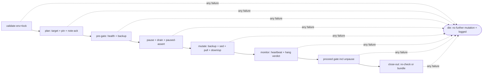
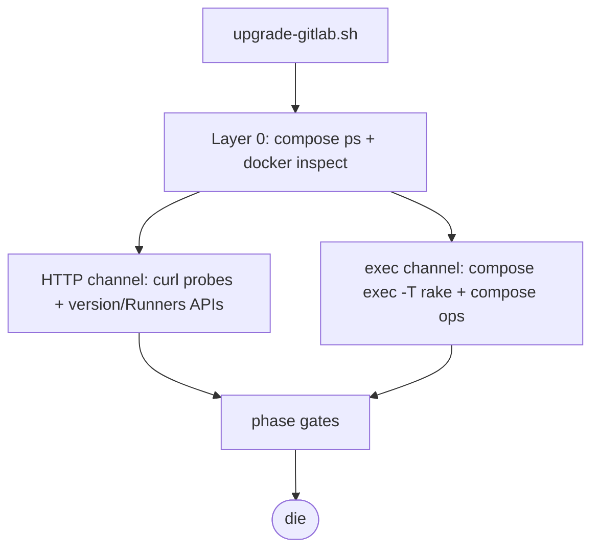
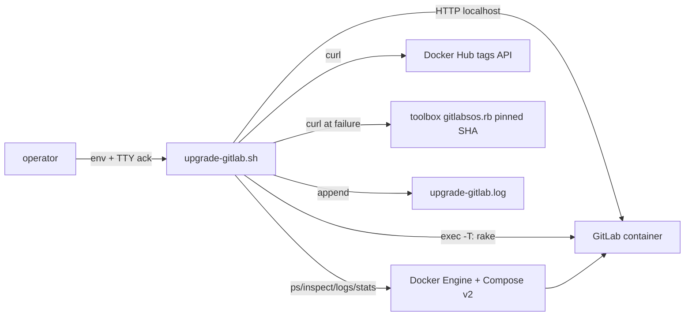

# Architecture Spine — GitLab Stepwise Upgrade Runner

## Design Paradigm

Gated sequential pipeline (phased script, fail-fast): a linear phase sequence where each phase either passes its gate or dies. No branching around a gate, no loop (one stop per run), no concurrency, no state file; every phase re-derives state from the live instance. Gate contents (endpoint roles, checklists, telemetry tables in `health-gates.md`; step order in `upgrade-procedure.md`; artifact terms in `backup-contract.md`) are binding and not duplicated here.

| Pipeline | Procedure |
| --- | --- |
| validate + plan (reads + note ack) | Phase 1 step 1 recon (read-only) |
| pre-gate + pause | Phase 1 step 2 act |
| mutate + monitor + proceed (unpause at step 6) | Phase 2 per-stop |
| close-out | Phase 3 |



## Invariants & Rules

### AD-1 — Single self-contained script [ADOPTED]

- **Binds:** all
- **Prevents:** decomposition drift (driver/libs splits, sourced helpers) and runtime creep that break line-by-line presentability
- **Rule:** the runner is one Bash file plus vendored `upgrade_path.yml`; no sourced files, readable top-to-bottom; Bash + curl (+jq with grep fallback) + git + docker/compose CLIs only — no Python or other runtimes; size governed by the mentor-presentation acceptance test, not a line ceiling

### AD-2 — One required stop per run [ADOPTED]

- **Binds:** CAP-1, CAP-3
- **Prevents:** range-parameter drift, multi-stop jumps skipping migration windows, and advancing past an unfinished stop
- **Rule:** each run advances exactly the next required stop after the detected current version; no range parameters; halt stating already-at-head when no entry follows; planning performs no health gating — the single pre-implementation gate (health + backup + leftover + CI, AD-10/AD-13/AD-15 scope) runs before any container change

### AD-3 — Version from the live instance via API [ADOPTED]

- **Binds:** CAP-1, CAP-5
- **Prevents:** trusting state the script itself wrote (compose `image:` line) and tag/API format mismatch
- **Rule:** current version comes from `GET /api/v4/version` with the admin token; normalize both sides (tag minus `-(ce|ee).0`, API value minus optional `-(ce|ee)`) and compare exact equality; expected edition derives from the `GITLAB_IMAGE_REPO` basename (`gitlab-ce` false, `gitlab-ee` true, anything else dies); asserted at startup and at proceed-gate step 1

### AD-4 — Stop list extracted by grep/sed over pinned YAML shape [ADOPTED]

- **Binds:** CAP-1
- **Prevents:** YAML-parser dependency creep and silent mis-parsing of the vendored file
- **Rule:** a short grep/sed pipeline reads list items of `major: <int>` + `minor: <int>` with an optional `comments: <text>` belonging to the preceding pair; anything else in the file dies; the vendored file carries a header citing source URL and fetch date; extraction keeps each note next to its stop

### AD-5 — Every stop is a normal stop; notes acknowledged up front [ADOPTED]

- **Binds:** CAP-1
- **Prevents:** conditional-stop interpretation logic creeping into the runner, and inconsistent acknowledgement
- **Rule:** all stops including conditional ones are taken as normal stops; the target note, if any, is shown with the plan print and acknowledged in the plan phase before pause/backup via the exact prompt `Type ACK <stop> to proceed:` (exact match, decline leaves zero side effects); required iff the note text is non-blank; a live run without a TTY halts with GATE=plan; `--plan` displays notes and never requires acknowledgement; each ack is logged as `ack stop=<s> at=<ts> note="<first 200 chars>"`

### AD-6 — Config via env vars with strict startup validation [ADOPTED]

- **Binds:** all
- **Prevents:** config-source drift, mid-run surprises from missing values, concurrent runs, and token exposure
- **Rule:** all configuration arrives as environment variables per the closed required/optional table in Conventions; a startup validation block names every missing/empty variable and halts before any action; normalize (strip trailing `/` from the URL and assert scheme+host; trim token whitespace; empty means unset for optional, missing for required); timeouts are literals, not env; an exclusive `mkdir` lock is taken first (die if held, trap release); secrets travel via curl `-K` file (mode 600, trap rm), never argv; token map is version+runners=admin, clone=smoke, health probes=none

### AD-7 — Channel discipline: Layer 0 first, checks never mutate [ADOPTED]

- **Binds:** CAP-2, CAP-4, CAP-5
- **Prevents:** refused-connection noise misread as sickness, wrong-tool invocation, and probe functions with hidden side effects
- **Rule:** check container state first via `docker compose ps` plus `docker inspect` (no `docker compose inspect` exists); every scripted `compose exec` passes `-T`; every curl probe carries `--max-time`; down means halt with no HTTP probes; Running means HTTP checks with the 10-minute grace after `up -d`; refused/timeout resolves through container state; unexpected 404 with Running reads allowlist-suspect; Exited (or Restarting past the timeout) halts with exit code plus log tail; every poll logs Layer-0 state alongside HTTP results; checks mutate nothing except the log append

### AD-8 — Halt contract: die() + frozen posture + belt-and-suspenders [ADOPTED]

- **Binds:** all
- **Prevents:** inconsistent failure handling, silent partial halts, lying audit logs, and auto-remediation creep
- **Rule:** one `die()` with fixed log format exiting non-zero; `die()` never mutates after detection except writing logs/bundle; the halt line carries dynamic `RUNNERS=`/`CONTAINER=` values, never literals; GATE vocabulary is `validate plan pre pause mutate monitor proceed unpause closeout`; values are single-quoted; fallible means external-command nonzero (gets `|| die`) while in-pipeline search/parse uses `|| true` plus explicit shape-assert-die; never retry `up` in the down window; the failure path never unpauses; INT/TERM trap into `die()` with the current-phase GATE

### AD-9 — Compose pinned by backup + in-place sed + down/up [ADOPTED]

- **Binds:** CAP-3
- **Prevents:** interpolation/overlay drift, wrong-service edits, and data-lossy recreate paths
- **Rule:** per run, scoped to `$COMPOSE_SERVICE`: `cp` the compose file beside itself as `$F.bak-<target>-<epoch>` (kept, never auto-restored — restore is a human action); `sed` anchored to the service stanza asserting exactly one `image:` line, else die; `pull`, then `down` and `up -d` (never `-v`); proceed even if the tag is identical (logged idempotent re-run)

### AD-10 — Rake table is the single migration signal [ADOPTED]

- **Binds:** CAP-2, CAP-4, CAP-5
- **Prevents:** verdict/delta source divergence and silent table-format mis-parses
- **Rule:** `gitlab-rake gitlab:background_migrations:status` via `exec -T` is the single source at all three sites (pre-gate leftover, monitor deltas, proceed verdict); parse contract is at least one `Database: <name>` banner with every other non-blank line shaped `status | csv`, else die; the verdict is every status `finished` or `finalized` (GitLab's terminal complete state; live 17.1.8 proves finalized rows occur — see demo-evidence-4-4/rake-status-17.1-leftovers.log); zero rows means clear; deltas come from done-count movement; `/health_check/migrations` is observed and logged but never resets the hang timer

### AD-11 — Verification is seeded runs + read-only plan mode [ADOPTED]

- **Binds:** all
- **Prevents:** test-harness machinery obscuring the presentable script, and plan/live divergence
- **Rule:** no unit harness; verification is runs against the seeded instance plus the injected-failure halt, with a read-only `--plan` mode that rehearses the single pre-implementation gate: it may perform any read — resolution plus every readable pre-pause check — dying in-format on the first failure, and stops before the first mutation; the plan is advisory — live runs always re-resolve; `--plan` validates the full config and never needs a TTY; it prints the one-hop plan plus the fixed checklist in stable order

### AD-12 — Failure bundle fetched at failure time with native fallback [ADOPTED]

- **Binds:** CAP-6
- **Prevents:** foreign-code review surface in the repo and bundle gaps when fetch or container is unavailable
- **Rule:** fetch standalone `gitlabsos.rb` pinned to toolbox SHA `cb73cacc` (2026-10-02) at failure time; `docker cp` into the container and run via `exec -T` with the embedded ruby and an explicit `-o` dir `./failure-bundle-<target>-<epoch>/` (logged); on fetch/run failure fall back to the native manifest (`logs --tail=500`, inspect, replay of recorded readiness/health lines from the log, best-effort rake status) and log the degradation; the bundle always includes recorded readiness per-service statuses plus `/health_check` failure messages; the rollback story is 4 fixed lines (backup path; image-revert sed; up command; unpause marked HUMAN-ACTION)

### AD-13 — CI quiet via Runners API, unpause-all on success only [ADOPTED]

- **Binds:** CAP-2, CAP-6
- **Prevents:** nonexistent rake-task paths, partially-quieted CI, and resuming jobs onto a broken instance
- **Rule:** enumerate via `GET /runners/all?per_page=100` following `Link rel="next"`; pause each via `PUT --form paused=true`, logging count plus IDs (zero is a logged no-op); drained means zero running jobs across all runners, polled every 10 s with heartbeat and no timeout (die only on query failure); assert-all-paused before mutate; unpause-all runs only on the success path at proceed-gate step 6; the log notes pre-existing paused runners also resume

### AD-14 — Latest-patch pin via Hub tags API, fail-closed [ADOPTED]

- **Binds:** CAP-1
- **Prevents:** pin divergence (pagination/sort/filter drift) and silently floating tags
- **Rule:** query the legacy Hub tags path with `name=<major.minor>&page_size=100`, following `next` to null; filter `^<M>.<m>.[0-9]+-(ce|ee).0$`; POSIX numeric patch sort, pick max; Hub failure or empty set dies (single attempt, no retry, no fallback)

### AD-15 — Backup verification against pinned demo layout [ADOPTED]

- **Binds:** CAP-2
- **Prevents:** contract-verification drift (layout/timestamp/run-start ambiguity)
- **Rule:** the demo artifact is `$BACKUP_PATH/` holding `data/` plus `secrets/` plus `BACKUP_CREATED_AT` (epoch seconds); fresh means `RUN_START - BACKUP_CREATED_AT <= 86400` with `RUN_START` captured as the script's first statement and logged; the ~15-line check halts naming the missing or stale item; Phase-1 recon never proceeds without a valid backup unless `--nobackup` is passed (run-wide skip, logged loudly, for testing before the producer exists); the demo backup is hand-made, stated not hidden

### AD-16 — Hang verdict from deltas plus telemetry; backends gate [ADOPTED]

- **Binds:** CAP-4
- **Prevents:** slow/hung mis-verdicts and gate/signal confusion during migration waits
- **Rule:** hung means 30 consecutive 10 s heartbeats with zero rake finished-count movement AND cpu integer-part zero AND block-I/O raw string unchanged — halt with GATE=monitor; any finished movement resets to 0; liveness 503 halts immediately; `/health_check/database` or `/cache` non-success halts; readiness is excluded from health-during (expected red); telemetry comes from one `docker stats --no-stream --format` sample per heartbeat and never gates alone



## Consistency Conventions

| Concern | Convention |
| --- | --- |
| Naming (entities, files, interfaces, events) | Script `upgrade-gitlab.sh`; vendored `upgrade_path.yml` with source-URL + fetch-date header; compose backup `$F.bak-<target>-<epoch>` beside the original; failure dir `./failure-bundle-<target>-<epoch>/`; lock `./upgrade-gitlab.lock`; env required: `GITLAB_URL GITLAB_ADMIN_TOKEN` (manage_runner scope) `GITLAB_SMOKE_TOKEN` (write_repository) `GITLAB_COMPOSE_FILE COMPOSE_SERVICE BACKUP_PATH SEED_PROJECT_PATH`; env optional: `GITLAB_IMAGE_REPO` (=gitlab/gitlab-ce) `LOG_FILE` (=./upgrade-gitlab.log) `UPGRADE_PATH_FILE` (=script-dir/upgrade_path.yml) |
| Data & formats (ids, dates, error shapes, envelopes) | UTC ISO-8601 (`date -u +%FT%TZ`); standard line `<ts> phase=<p> msg="<..>"`; die line adds `GATE= EXPECTED= OBSERVED= ACTION= RUNNERS= CONTAINER=` single-quoted; `target=` on lines after plan resolves; heartbeat ordered `hb elapsed_s=<int> health=<OK/FAIL> liveness=<200/503/REFUSED> cpu_raw="<..>" mem_raw="<..>" bio_raw="<..>" net_raw="<..>" rake_finished=<int> rake_total=<int> rake_delta=<signed>`; `--plan` checklist fixed order: pre-health, pre-migrations-leftover, pre-backup, proceed-version, proceed-migrations, proceed-backends, proceed-readiness, proceed-smoke-main, proceed-recheck-unpause, closeout |
| State & cross-cutting (mutation, errors, logging, config, auth) | `jq -r` when present else `grep -oE` fallback; each probe defines its jq filter AND grep regex AND byte-identical bare output (e.g. version yields bare `X.Y.z`); `PARSER` detected once at startup, exported, never re-detected; curl always with `--max-time` plus shape-asserted output; secrets per AD-6; re-runs are stateless; source layout top-to-bottom is constants, strictness+trap, log/die, probes, phases in execution order, arg-parse, main |

## Stack

| Name | Version |
| --- | --- |
| bash | Portable floor: any Bash 3.2+ running a POSIX-sh-compatible subset (no assoc arrays, mapfile, case-modification) |
| curl | Any with `-K/--config`, `--max-time`, `--fail` (long-stable flags; upstream 8.23.x current 2026-10) |
| jq | Optional, any 1.6+; grep fallback otherwise |
| git | Any 2.x (clone + push only) |
| Docker Engine | Any with `docker inspect` + `docker stats --no-stream --format` |
| Docker Compose | v2 plugin with ps, logs, exec -T, stats, pull/down/up -d accepting service args |
| GitLab images | 16.11–17.x CE/EE; rake `:status` grammar per the 16-11-stable source |
| Vendored upgrade_path.yml | master config/upgrade_path.yml plus fetch-date header |
| gitlabsos.rb | toolbox at cb73cacc (2026-10-02), fetched at failure time |
| Health-check semantics | docs.gitlab.com/administration/monitoring/health_check (gold standard) |

## Structural Seed

Single-node Docker Compose; the operator runs the script with Docker control beside the compose project; probes hit localhost HTTP; downtime upgrade in a connected environment (Hub tags API at plan, toolbox fetch at failure — the failure path degrades to the native bundle offline).



```text
runner/
  upgrade-gitlab.sh   # the single-file runner (AD-1)
  upgrade_path.yml    # vendored stop list with source header (AD-4)
```

## Capability → Architecture Map

| Capability / Area | Lives in | Governed by |
| --- | --- | --- |
| CAP-1 next-stop plan | plan phase (extract, pin via Hub API, print, note ack) | AD-2, AD-3, AD-4, AD-5, AD-14 |
| CAP-2 pre-upgrade gate | pre-gate phase (health + backup contract) | AD-6, AD-7, AD-10, AD-13, AD-15 |
| CAP-3 one stop advance | mutate phase (backup, sed, pull, down/up) | AD-2, AD-9 |
| CAP-4 health-during | monitor phase (heartbeat + deltas + hang verdict) | AD-7, AD-10, AD-16 |
| CAP-5 proceed gate | proceed-gate phase (ordered 6-step contract in health-gates.md) | AD-3, AD-10 |
| CAP-6 close-out | close-out phase (re-check or diagnostics bundle + rollback story) | AD-12, AD-13 |
| Cross-cutting halt/log | die(), log format, strictness | AD-8 |

## Deferred

- Secrets manager / short-lived credentials for tokens (demo uses plain exported disposables)
- Retry/resume within a stop (re-run from scratch instead)
- Multi-node, zero-downtime, and Helm topologies
- Backup implementation (follow-on deliverable; this runner only verifies the contract)
- GitLab Runner container/binary upgrade (out of scope; CI quiet via API only)
- Maintenance mode (Premium+; Free-tier demo quiesces via downtime + paused CI + recreation)
- Geo, external Gitaly, Elasticsearch, K8s agents (known but out of scope)
- Archive scraping for stops outside the demo range
- Troubleshooting detail and Support handoff beyond the failure bundle and rollback statement
