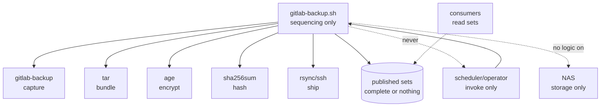
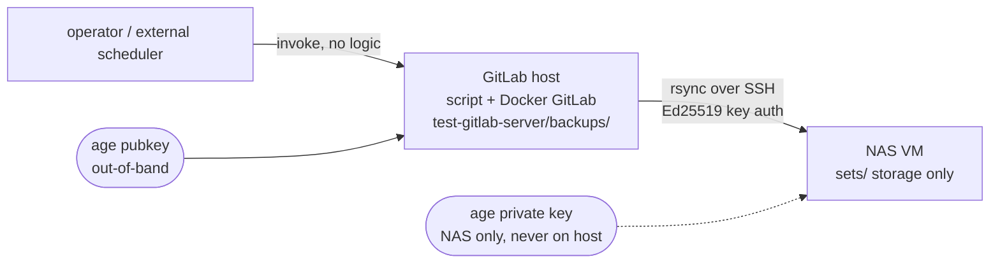

# Architecture Spine — gitlab-backup

## Design Paradigm

Pipes-and-filters: six linear stages, one direction, no loops. The timestamped set
directory is the pipe; each stage reads only prior stages' outputs and appends its own.


`CAPTURE` (native tarball) → `BUNDLE` (tarball + config volume + compose + env → `set.tar`) →
`ENCRYPT` (`set.tar` → `set.tar.age`, wipe plaintexts) → `HASH` (single hash over
sealed blob) → `SHIP` (rsync to remote staging, re-verify, remote-publish) → `PRUNE` (local newest-N).

## Invariants & Rules



### AD-1 — Staged fail-fast pipeline [ADOPTED]

- **Binds:** all
- **Prevents:** stages interleaving, hidden coupling, untestable monolith
- **Rule:** Exactly the pipe stages `CAPTURE → BUNDLE → ENCRYPT → HASH → SHIP → PRUNE`
  in order (`CONFIG` and `LOCK` are pre-pipe gates, not pipe stages). The run preamble
  creates an empty `.staging-<ts>/` (abort if it or `<ts>/` already exists). `CAPTURE`
  writes exactly one native tarball into staging — the file its own `create` produced
  (never newest-wins over history), read from the host-visible data bind
  (`$GITLAB_DATA_DIR/backups/`; reading the finished tarball is capture output, not a
  volume copy). `BUNDLE` requires exactly one `*_gitlab_backup.tar` in staging, stages
  copies of the config volume (as `config/`), the compose file (source basename), and `.env` from the compose file's directory (required — missing file fails `FAIL:BUNDLE`), `cmp`s
  each copy against live (byte-identical or `FAIL:BUNDLE`), and tars exactly
  `{<native-tarball-name>, config/, <compose-basename>, .env}` (relative members, plain
  `tar -cf`, no compression, all other flags system defaults, no absolute paths) into
  `set.tar`. `ENCRYPT` seals `set.tar` to `set.tar.age` with exactly one `age` invocation
  and deletes exactly {native tarball, staged `config/`, staged compose copy, staged `.env`, `set.tar`}.
  `HASH` runs only on the sealed blob and ends by publishing (the `mv` in AD-2 belongs
  to `HASH`); `SHIP` reads only from the published `<ts>/`, never from staging. A stage
  reads only artifacts prior stages left in the set dir plus its AD-6-declared source
  inputs, and never re-runs a prior stage. Any stage failure aborts the run immediately
  (AD-7).

### AD-2 — Set-as-unit atomicity [ADOPTED]

- **Binds:** CAP-1, CAP-4, CAP-5, CAP-7
- **Prevents:** any consumer ever seeing a half-built set
- **Rule:** At the publish gate, staging holds exactly two entries named exactly
  `set.tar.age` and `SHA256SUMS` — anything else is half-built — e.g. plaintext `set.tar` present but `set.tar.age`
  missing (encrypt failed), `.age` present but `SHA256SUMS` missing (hash failed),
  leftover plaintexts sitting beside the `.age` (wipe failed), or a `SHA256SUMS` that
  doesn't verify. Publish happens only when both members are present AND
  `sha256sum -c SHA256SUMS` passes inside staging; any third entry aborts with `FAIL:HASH`, never publishes. In-progress staging legitimately holds intermediates — the exactly-two rule applies at the gate only.
  The move is one atomic directory rename — `mv .staging-<ts> <ts>` — not
  per-file moves; there are no `.bak` files, and already-published sets are never
  renamed or touched. Anything listing visible `<ts>/` dirs sees a complete set
  or nothing. The `<ts>` is computed once at run start and reused for staging,
  publish, and remote paths; publish aborts if `<ts>/` already exists. The same
  staging discipline mirrors on the NAS (AD-5), so consumers of either side see
  complete sets or nothing. An `ERR` trap plus `EXIT`-when-nonzero removes local and remote staging
  (and only staging on each side — never published sets, including on `PRUNE`
  failure) on failure; remote cleanup runs `|| true` and never masks the original `FAIL`.

### AD-3 — Bash sequences, tools execute [ADOPTED]

- **Binds:** all
- **Prevents:** crypto/checksum/transfer logic drifting into bash (or vice versa)
- **Rule:** Each stage's defining effect goes through one domain tool: `gitlab-backup`
  via `docker exec` (capture), `tar` (bundle), `age` (encrypt), `sha256sum` (hash),
  `rsync`/`ssh` (ship), `rm` (prune) — one domain tool per stage, matching AD-1. Any
  stage may also use the closed utility set (`mv`, `rm`, `mkdir`, `cmp`, `flock`, `test`);
  nothing else executes. Bash does sequencing, argument validation, and error naming
  only. No Python, no embedded crypto, no retry logic that duplicates tool flags, no
  scheduler logic. Encryption is exactly one `age` invocation sealing `set.tar` to
  `set.tar.age` against the NAS public key — no fallback cipher, no alternate tool — and
  the wipe set is `rm`d only after `age` exits 0 with every `rm` checked: any `rm` failure
  is `FAIL:ENCRYPT`, so a failed encrypt leaves plaintext inside staging where the trap
  removes it (AD-2). `SHIP`'s local `sha256sum -c` re-run (AD-5) is read-only
  re-verification, not a second hash effect.

### AD-4 — Plaintext secrets never leave the host [ADOPTED]

- **Binds:** CAP-2, CAP-5
- **Prevents:** accidental plaintext shipment; key material in repo or logs
- **Rule:** The set archive is encrypted to the NAS `age` public key before
  hashing and shipping. The NAS private key never exists on the GitLab host. The
  public key arrives out-of-band as a file path (`AGE_PUBKEY_FILE`), never hardcoded. The invocation is `age -R "$AGE_PUBKEY_FILE" -o set.tar.age set.tar` (binary, no armor), run with cwd inside staging; the key file holds a single `age1…` line — anything else fails `FAIL:CONFIG` at up-front validation.
  Plaintext staging is wiped after encryption. The single hash covers the encrypted bytes; there are no inner hashes.

### AD-5 — Emit a complete set; judge nothing [ADOPTED]

- **Binds:** CAP-4, CAP-5
- **Prevents:** producer accumulating consumer-specific checks (freshness, validity, fitness)
- **Rule:** The producer emits exactly {sealed blob (`set.tar.age`), `SHA256SUMS`}, hashed pre-ship. `SHA256SUMS` is exactly one line — 64 lowercase hex, two spaces, `set.tar.age`, trailing newline — generated with cwd inside the set dir on the bare filename (no directory components, no `*` marker, no second line); the same file passes `sha256sum -c` unmodified in local staging, local published, and remote staging. `SHA256SUMS` is written once by `HASH`; `SHIP` only reads and verifies it, never modifies it.
  `SHIP` first re-runs `sha256sum -c` locally, then ships contents-mirror — `rsync -a -e "ssh -i $SSH_KEY_FILE" "$BACKUP_DIR/<ts>/" "$NAS_USER@$NAS_HOST:$NAS_DIR/.staging-<ts>/"` (note trailing slashes) — then over `ssh -i $SSH_KEY_FILE $NAS_USER@$NAS_HOST`: presence check (`test -f` both members, else `FAIL:SHIP:missing-member`) followed by `(cd <NAS_DIR>/.staging-<ts> && sha256sum -c SHA256SUMS)` (else `FAIL:SHIP:hash-mismatch`), and only then renames remotely to `<NAS_DIR>/<ts>/` — aborting if `<NAS_DIR>/<ts>/` already exists (the remote `mv` never runs onto an existing path). All remote paths absolute. It asserts nothing
  about freshness, validity, or fitness for any consumer's purpose — no age
  checks, no validity certificates, no consumer-specific logic. What any consumer
  does with a set is that consumer's business.

### AD-6 — Environment in, nothing hardcoded [ADOPTED]

- **Binds:** all
- **Prevents:** a script welded to one machine; settings drift between builders; secrets on process lists
- **Rule:** Every environment-specific value — NAS hostname, backup dir, container
  name, compose path, config volume path, data volume path, key paths, tool paths — resolves by precedence **real
  env > `backup.env` file > built-in default**. The script sources `$SCRIPT_DIR/backup.env`
  when present (`ENV_FILE` overrides the path); a tracked `backup.env.example`
  documents every variable with its POC default, while the real file is gitignored
  and holds no secrets (key paths, never key material). Everything is validated up
  front: fail fast with `FAIL:CONFIG` before any capture, not halfway through a
  50GB tarball. Validation covers: required vars non-empty; referenced files exist and are readable; `BACKUP_DIR` writable; key file holds a single `age1…` line; container and compose file present (`docker inspect`, read-only). No network probes — an unreachable NAS surfaces as `FAIL:SHIP`. Secrets never travel via `argv` (visible in `ps`). No host, path,
  or key literal outside the defaults block — the same script runs on the test box
  and the real host with only env/file changes. Defaults target the reference (POC)
  box so a bare run with no file just works; values with no safe default (notably
  the `age` public key) are required and fail fast. `GITLAB_CONFIG_DIR` defaults to `$(dirname "$COMPOSE_FILE")/volumes/config`, `GITLAB_DATA_DIR` to `$(dirname "$COMPOSE_FILE")/volumes/data`, `AGE_BIN` to `$SCRIPT_DIR/vendor/age`. Canonical variable registry
  (`backup.env.example` is the single owner): `BACKUP_DIR NAS_HOST NAS_USER NAS_DIR SSH_KEY_FILE AGE_PUBKEY_FILE
  GITLAB_CONTAINER GITLAB_CONFIG_DIR GITLAB_DATA_DIR COMPOSE_FILE AGE_BIN
  VERBOSE ENV_FILE`. New variables enter the registry with default + comment in the same epic
  that introduces them; no epic invents a variable that bypasses it.

### AD-7 — Loud failure, named stage, nothing partial [ADOPTED]

- **Binds:** CAP-7
- **Prevents:** silent partial success; unactionable scheduler alerts
- **Rule:** `set -euo pipefail`. Order: resolve + validate config → compute `<ts>` once → acquire lock → `mkdir` staging. Single-flight via `flock` on `<backups>/.lock`; contention emits exactly one `FAIL:LOCK:ts=-:<detail>` line to stderr and exits 1 — `LOCK` emits no `START`/`DONE`, takes no stdout. Fixed output grammar (stage vocabulary: `CONFIG CAPTURE BUNDLE ENCRYPT HASH SHIP PRUNE LOCK`): `START <STAGE> ts=<ts>` and `DONE <STAGE> ts=<ts> [detail]` to stdout — stdout carries only grammar lines; tool output goes to stderr when `VERBOSE=1`, else `/dev/null`; `FAIL:<STAGE>:ts=<ts>:<detail>` (detail required) to stderr, exit 1 — `ts=-` exactly when the run dies before `<ts>` assignment (lock contention, pre-assignment config errors), real `<ts>` after. The trap leaves no partial set (AD-2). Numeric exit taxonomy is deferred — v1 exits 1 for all failures.

### AD-8 — Whole-set pruning, newest wins [ADOPTED]

- **Binds:** CAP-6
- **Prevents:** piecemeal deletion; mtime-vs-name ordering drift
- **Rule:** After a successful ship + remote re-verify, keep the newest 2 set dirs in local `<backups>/` only — `PRUNE` never touches the NAS —
  by dirname sort (never mtime); only entries matching `^[0-9]{8}-[0-9]{6}$` participate
  (`.staging-*` and `.lock` are never victims); `rm -rf` whole losers only. Prune never
  runs unless the current set shipped and verified (`SHIP` exited 0 this run — no
  remote re-probe). Count is fixed at 2 for the demo; no retention variable exists in v1.

## Consistency Conventions

| Concern | Convention |
|---|---|
| Naming (dirs, files) | Set dir `<backups>/<ts>/`, `<ts>` = UTC `YYYYMMDD-HHMMSS`, computed once per run. Sealed blob is `set.tar.age`; hash file is `SHA256SUMS` (one line). Staging is `.staging-<ts>/`, local and remote. |
| Data & formats | `SHA256SUMS` is one line (64 lowercase hex, two spaces, `set.tar.age`, newline — see AD-5), checkable with `sha256sum -c`. No JSON in v1 — plain text, audit-readable. Timestamps UTC only, spelled `date -u +%Y%m%d-%H%M%S`. |
| Terminology | `bundle` = tar step, `seal`/`encrypt` = age step (synonyms); `set archive`/`set.tar` = plaintext tar; `sealed blob`/`set.tar.age` = encrypted output; `hash file`/`SHA256SUMS` = the hash. `manifest` is banned. |
| Unit contract | Stage functions `capture bundle encrypt hash ship prune` (lowercase, `<ts>` as `$1`, exit code + `FAIL:` lines only). Every external tool overridable without editing the script: `age` via `$AGE_BIN` (default `$SCRIPT_DIR/vendor/age`); container/ssh tools via `PATH`. |
| Runner read path | `$BACKUP_PATH` is the parent contract's name for the runner's read root — parent `backup-contract.md` v2 owns its definition. Producer writes local `<BACKUP_DIR>/<ts>/` and remote `<NAS_DIR>/<ts>/`; no mapping asserted here. |
| Set contents | Exactly native tarball + whole config volume (`/etc/gitlab` bind) + compose file + `.env` → `set.tar` → `set.tar.age`. Nothing else enters the set. |
| Explainability (mentor-graded) | One named function per stage; every tool invocation preceded by a comment stating intent; no cleverness (`eval`, dynamic dispatch, cryptic one-liners). |
| State & cross-cutting | Mutation only via staging→publish (AD-2). Fixed output grammar (AD-7); stage progress to stdout. Config via env + `backup.env` (AD-6). Auth: SSH key (Ed25519) + `age` pubkey file. `VERBOSE=1` gates tool output. |

## Stack

Seed — verified current at authoring; the code owns this once it exists.

| Name | Version |
|---|---|
| bash | ≥5.0, prefer 5.3 (latest stable Jul 2025) |
| gitlab-backup (GitLab version pinned by the compose file under backup, CAP-3) | `docker exec -t <container> gitlab-backup create STRATEGY=copy` (mechanism verified current per official docs, 12.2+ through 19.x) |
| age (vendored static binary) | 1.3.x — vendor 1.3.2 (Aug 2026; X25519 recipients) |
| rsync | ≥3.5.1 both ends (pre-3.5.0 carries 33 CVEs; 3.5.0 regressed — verify with `rsync --version`) |
| OpenSSH (key auth, Ed25519) | ≥9.x, prefer 10.x (10.6 Oct 2026) |
| sha256sum (coreutils, system) | system version; output format stable |
| BATS (tests) | bats-core ≥1.13 (1.14.0 Oct 2026), system or vendored |

## Structural Seed

Deployment & environments (this altitude owns the operational envelope):



One set on disk:

```text
backups/
  20261103-120000/
    set.tar.age  # the whole set, sealed
    SHA256SUMS   # one hash, sha256sum -c compatible
```

Source tree:

```text
backup/
  gitlab-backup.sh   # the whole producer
  backup.env.example # documented settings template (tracked; real backup.env is gitignored)
  vendor/age         # vendored static binary (air-gap)
tests/
  *.bats             # per-stage + induced-failure (CAP-7) tests
```

## Capability → Architecture Map

| Capability / Area | Lives in | Governed by |
|---|---|---|
| CAP-1 capture | `CAPTURE` stage | AD-1, AD-2, AD-3 |
| CAP-2 set assembly | `BUNDLE` + `ENCRYPT` stages | AD-1, AD-3, AD-4 |
| CAP-3 compose copy | `BUNDLE` stage | AD-1, AD-3 |
| CAP-4 hashing | `HASH` stage | AD-1, AD-3, AD-5 |
| CAP-5 ship | `SHIP` stage | AD-1, AD-2, AD-4, AD-5 |
| CAP-6 local retention | `PRUNE` stage | AD-1, AD-8 |
| CAP-7 all-or-nothing | lock + traps + staging (cross-cutting) | AD-2, AD-7 |

## Deferred

- Scheduling, retention-horizon enforcement (7/4/3–6 on NAS), off-site copies —
  declared policy in `retention-policy.md`, enforced by operators/schedulers, not code.
- Automated restore (stays manual/documented); log backup (skipped by design).
- Numeric exit-code taxonomy (v1: exit 1 + `FAIL:<STAGE>`).
- CLI flags and structured config formats (ini/yaml) — v1 is env > env-file > defaults.
- Parallel stages, retries beyond tool flags, NAS-side logic of any kind.
- `age` key rotation procedure.
- Packaging/deployment beyond running from a checkout on the host (revisit when leaving POC).
- Log capture/rotation beyond stdout/stderr (owned by scheduler/journal; revisit if logs need retention).
- Consumer-side contract and verification (parent `backup-contract.md` v2 and
  whatever checks its owner defines) and NAS VM provisioning — acceptance
  dependencies owned elsewhere, not this build.
- Single-script split: stays one file until the Rule of Three earns a `lib/`.
